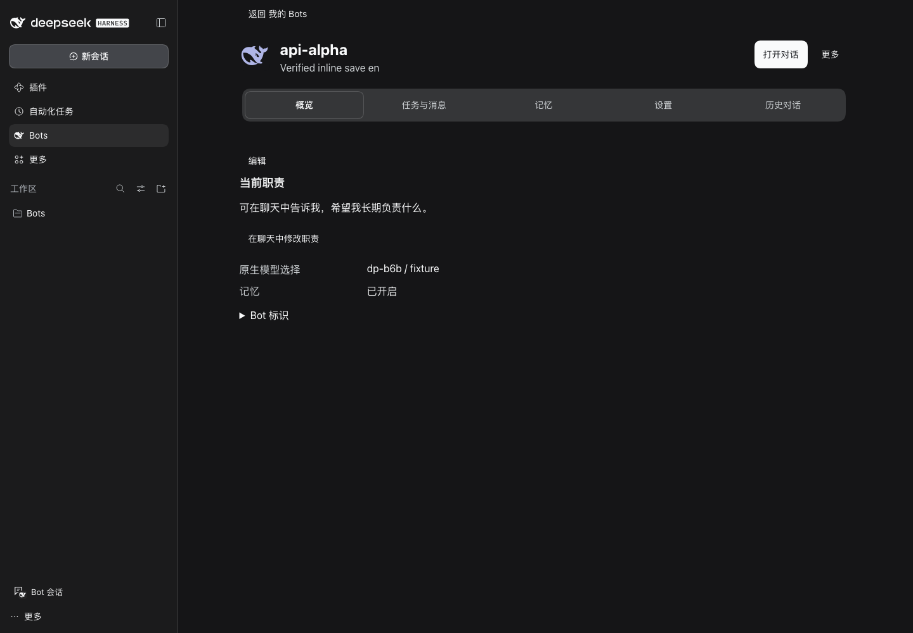
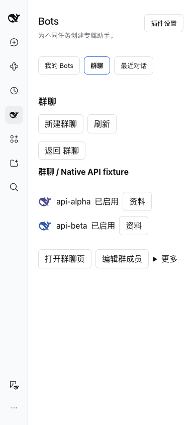

# DSH-Bot

English · [中文](README.md)

Personal agents for DeepSeek Harness. Create Bots with their own personas, long-term memory, models, skills and tools, then chat and collaborate in the native workspace.

The current version is **0.6.3**. The prebuilt package is available in [GitHub Release v0.6.3](https://github.com/MJ-CJM/DSH-Bot/releases/tag/v0.6.3). Community listing is being requested; no npm package has been published. Licensed under [MIT](LICENSE), Copyright © 2026 MJ-CJM. Third-party notices are included in the package.

## Features

- **Create and chat**: create a Bot with only a name and receive a short introduction on first opening. Save lasting roles through native approval, inspect the current role, or request a change in chat. Search, pin, hide and restore recent conversations.
- **Workspace groups**: choose members and use a native conversation with mentions, replies, attachments, concurrent work, precise follow-ups and individual cancellation. Select models and reasoning effort per group or member; permissions use native controls.
- **Memory and skills**: private Bot memory, explicitly user-published shared memory, search and forgetting management. Edit the Bot's own `SKILL.md` files and preview bounded imports and exports.
- **Collaboration and tasks**: `bot_message` asks another Bot in its persistent main conversation; `bot_delegate` starts a one-off native child task. Schedules reuse DSH services, with delivery and response observations shown separately.
- **Optional integrations**: managed MCP connectors per Bot, in-app notifications and an additional Reference Memory graph. The native Agent Teams board is available when enabled by the Host.

## Install and upgrade

Community installation URL: [latest stable dsh-bot.tgz](https://github.com/MJ-CJM/DSH-Bot/releases/latest/download/dsh-bot.tgz). Download `dsh-bot.tgz.sha256` from the same Release and verify with `shasum -a 256 -c dsh-bot.tgz.sha256` (macOS) or `sha256sum -c dsh-bot.tgz.sha256` (Linux). The URL follows stable releases; existing installations still require an upgrade. The pinned-version instructions below remain available for reproducible installs.

DeepSeek Harness is required. Development dependencies and the read-only API reference are pinned to **0.2.1-rc.2**. The release archive completed installation, reinstallation and cold recovery on **rc.2**, plus group UI checks on **rc.2 / rc.5**. See the [release record](docs/releases/v0.6.3.md) for results and the distinction from historical evidence. The declared range is `>=0.2.1-rc.2 <0.3.0`, which does not establish verified compatibility with every version in that range.

1. Download the `dsh-bot-0.6.3.tgz` and `SHA256SUMS` assets from [GitHub Release v0.6.3](https://github.com/MJ-CJM/DSH-Bot/releases/tag/v0.6.3), not the automatically generated Source code archives. In the download directory, verify with `shasum -a 256 -c SHA256SUMS` on macOS or `sha256sum -c SHA256SUMS` on Linux. Developers can also build from this checkout as described below.
2. Open DSH **Plugins → Add plugin → Install third-party plugin** and select the tgz. Enter its absolute path if the dialog requests an installation source.
3. Confirm that it is enabled, **fully quit DSH and reopen** (Cmd+Q on macOS), then enter **Bots** from the sidebar. Two examples are created only when no Bot data exists on first activation.

Before upgrading, back up the original profile and complete data. Keep the same `DSH_HOME`, profile and storage configuration; add the new package through the same installation flow and fully reopen DSH. An in-place 0.6.2 → 0.6.3 upgrade, installed-file audit and data retention are recorded in the [desktop acceptance report](docs/acceptance/V063-desktop-install.md). If your Host requires removing the old plugin first, plugin removal is separate from Bot deletion. Do not delete data directories or reset the profile.

See the [community release guide](docs/community-release.md) for CLI installation, migration and release preparation. Memory migration from 0.4.0 writes a Migration Fence that old plugins reject. Do not downgrade and continue writing to that storage. Rollback requires a separate complete pre-upgrade backup and review of whether forgotten data could reappear from old copies.

## Screenshots

Actual current-version UI in an isolated Web Host with synthetic demo data. These screenshots do not establish real-model task quality.





## Usage and data boundaries

In **Bots**, choose **＋ → New Bot**, enter a name and open its native main conversation. Choose at least two Bots to create a group. Group management handles membership and settings; chat stays in the workspace. Running tasks accept follow-up input and individual stops. Completed or cold-restored child tasks require a new delegation from the main conversation. Uncertain results are never automatically replayed.

Use **Manage → Memory and import/export** for private and shared memory. Model tools are `bot_memory_save`, `bot_memory_search`, `bot_memory_list` and `bot_memory_forget`. The old `memory_*` names have no aliases; refresh tool definitions in old sessions. Model saves stay private to the Bot; publishing shared content requires explicit user confirmation. Deleting a Bot deletes its private memory by default and keeps its home. Published shared contributions require the separate forgetting preview.

The default conversation cwd is `$DSH_HOME/dsh-bot/bots`. Each Bot's `home` is an organization convention, **not a filesystem isolation boundary**. Files, commands and privilege changes remain subject to DSH's native permissions, approval and sandbox. The default `nativeToolPolicy=native` trusts the loaded single-user Host; it does not isolate arbitrary scripts against data exfiltration. Existing strong-forgetting records can keep unaudited general tools blocked across the memory domain. A new main conversation does not remove that protection. Do not delete forgetting records to bypass it.

## Evidence and current limits

Recorded checks cover isolated Hosts, synthetic models, tgz installation audits and Web UI in both languages, themes and wide/narrow layouts. Desktop records cover installation, cold startup and read-only UI inspection. **Synthetic models establish workflow and routing behavior; real-model wording, role understanding, task quality and third-party service outcomes remain unverified.** See [0.6.3 acceptance](docs/acceptance/V063-onboarding-avatars.md) and the [changelog](CHANGELOG.md). These historical receipts do not mean this checkout has automatically reproduced those runs.

- Ongoing proactive attention, a primary Bot, external-event wakeups, cloud hosting and operation after the computer sleeps or exits have not shipped. A first greeting is not an ongoing proactive agent.
- IM binding, inbound and outbound gates remain unverified and disabled. OS/mobile push, full voice conversations, hosted accounts, payments and public sharing services have not shipped. In-app notifications do not establish external delivery.
- Automatic sharing is unavailable without verified human ingress. Proactive checks and offline organization default to off; offline evaluations test synthetic mechanisms rather than real-world quality.
- Only one active Host per data backend is supported. Background results are not guaranteed after a forced crash. Schedule delivery and a completed reply do not establish successful task outcomes.

See the [architecture](docs/architecture.md) and [deepening acceptance](docs/acceptance/deepening.md) for further boundaries.

## Local development

Requirements: Git, Node.js `^22.19.0 || >=24.0.0` and pnpm `11.28.5`. Use repository wrappers for tools; a global installation is not required. DSH CLI is needed only for Host validation.

```sh
scripts/pnpm install --frozen-lockfile
scripts/pnpm check
scripts/pnpm check:docs
scripts/pnpm pack:plugin
```

For Host work, use only the repository-isolated directory:

```sh
DSH_HOME="$PWD/.dsh-dev" scripts/dev-profile.sh
# For another compatible 0.2.x CLI, explicitly select a run that records its actual version:
DSH_HOME="$PWD/.dsh-dev" scripts/dev-profile.sh --compatible
scripts/grok-dev-host.sh --help
```

`check` is self-contained for the current source. Historical package regressions use the separate `scripts/pnpm test:release`; see [Contributing](CONTRIBUTING.md) for prerequisites. `dev-profile.sh` checks installation and dump-config only; it does not start a Host. Full runtime and browser checks need additional setup and must run serially. Preserve existing `.dsh-dev` data and evidence instead of clearing the directory to retry. Local evidence shown as code paths is not included in a clone.

Use the [issue templates](https://github.com/MJ-CJM/DSH-Bot/issues/new/choose) for bugs and suggestions, read [Contributing](CONTRIBUTING.md) before submitting changes, and consult the [security policy](SECURITY.md) before reporting sensitive issues.
