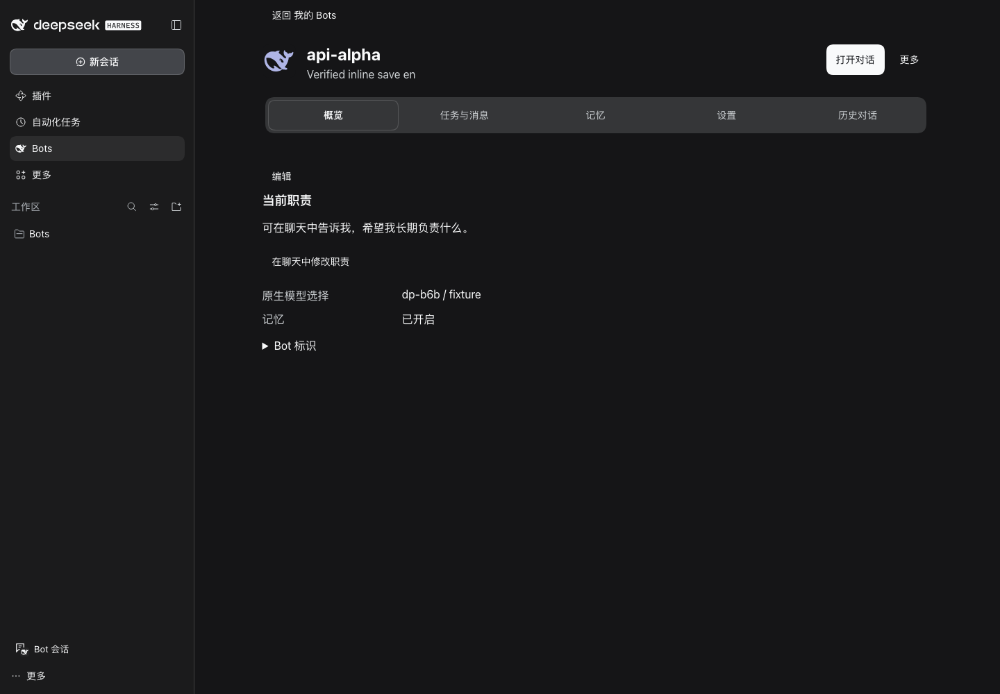
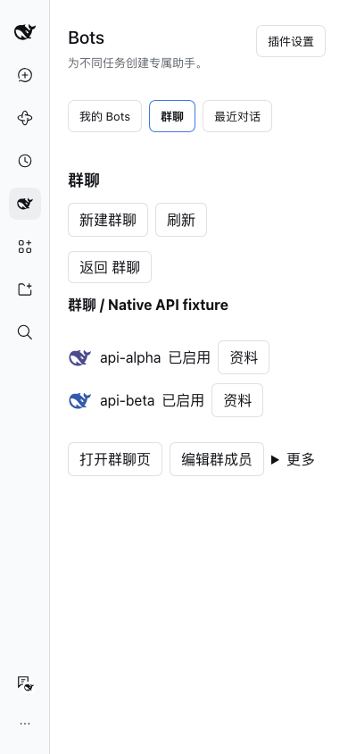

# DSH-Bot

[English](README.en.md) · 中文

DeepSeek Harness 的个人智能体插件。创建拥有各自人设、长期记忆、模型、技能和工具的 Bot，在原生工作区里私聊、群聊和协作。

当前版本 **0.6.3**。预构建安装包已发布于 [GitHub Release v0.6.3](https://github.com/MJ-CJM/DSH-Bot/releases/tag/v0.6.3)。社区目录收录申请进行中，尚未发布 npm 包。采用 [MIT 许可证](LICENSE)，Copyright © 2026 MJ-CJM；第三方告知随包提供。

## 可以做什么

- **创建即聊天**：只需名称即可创建 Bot；首次打开生成简短开场。长期职责通过原生审批保存，当前职责可查看或在聊天中修改。最近会话支持搜索、置顶、隐藏与恢复。
- **工作区群聊**：选择成员后直接进入原生会话，支持 `@`、引用、附件、并行工作、精确补充和单项停止。可为群或每位成员选择模型与推理等级，权限沿用原生入口。
- **记忆与技能**：每 Bot 私有记忆、用户明确发布的共享记忆、搜索与遗忘管理；可编辑 Bot 自有 `SKILL.md`，导入导出有预览与范围限制。
- **协作与任务**：`bot_message` 向另一 Bot 的持久主会话提问；`bot_delegate` 启动一次性原生子任务。定时任务复用 DSH 原生服务，应用内展示投递与回复状态。
- **按需扩展**：每 Bot 受管 MCP 连接器、应用内通知、可选 Reference Memory 图谱；宿主启用 Agent Teams 时可使用原生任务板。

## 安装与升级

需要 DeepSeek Harness。开发依赖与只读 API 参考锁定 **0.2.1-rc.2**；首发安装包在 **rc.2** 完成安装、重装和冷恢复，并在 **rc.2 / rc.5** 完成群聊界面复验；逐项结果及历史证据区别见[首发记录](docs/releases/v0.6.3.md)。包声明范围为 `>=0.2.1-rc.2 <0.3.0`，不代表范围内所有版本均已验收。

1. 从 [GitHub Release v0.6.3](https://github.com/MJ-CJM/DSH-Bot/releases/tag/v0.6.3) 下载附件 `dsh-bot-0.6.3.tgz` 和 `SHA256SUMS`；不要选择自动生成的 Source code 压缩包。在下载目录用 `shasum -a 256 -c SHA256SUMS`（macOS）或 `sha256sum -c SHA256SUMS`（Linux）核对。开发者也可按下文自行构建。
2. 在 DSH 打开 **插件 → 添加插件 → 安装第三方插件**，选择 tgz（需要来源时填写其绝对路径）。
3. 确认启用后**完全退出 DSH 并重开**（macOS 使用 Cmd+Q），在侧栏进入 **Bots**。首次启用且没有既有 Bot 数据时会创建两个示例。

升级前备份原 profile 和完整数据，保持原来的 `DSH_HOME`、profile 与存储配置，通过同一安装入口添加新版包，然后完全退出重开。已有 0.6.2 → 0.6.3 原位升级、安装文件核对与数据保留记录，见[桌面安装验收](docs/acceptance/V063-desktop-install.md)。若宿主要求先卸载插件，卸载不等于删除 Bot；不要删除数据目录或重置 profile。

CLI 安装、迁移与发布步骤见[社区发布说明](docs/community-release.md)。0.4.0 起的记忆迁移写入 Migration Fence，旧插件会拒绝该存储；不能直接降级继续写入。回退需要升级前独立完整备份，并评估遗忘后旧副本复活风险。

## 界面预览

当前版本在隔离 Web Host 中的真实界面，使用合成演示数据；不代表真实模型任务质量。





## 使用与数据边界

在 **Bots** 点“新建 Bot”，输入名称后进入原生主会话。创建群时选择至少两位 Bot；群管理负责成员和设置，聊天始终在工作区进行。运行中的任务可补充或单独停止；已结束或冷恢复的子任务须回主聊发起新委派，不确定回传不自动重放。

在 Bot 的 **资料 → 记忆** 或 **插件设置 → 记忆与导入导出** 管理私有与共享记忆。模型使用 `bot_memory_save`、`bot_memory_search`、`bot_memory_list`、`bot_memory_forget`；旧 `memory_*` 名没有别名，旧会话须刷新工具定义。模型保存只写本 Bot 私有记忆，共享正文须由用户明确确认。删除 Bot 默认删其私有记忆、保留 home；已发布共享贡献须通过单独的遗忘预览处理。

资料页提供概览、任务与消息、记忆、设置和历史，返回后保留列表位置。群聊每个问题下的执行入口默认收起；展开可查看各成员原生思考，成员菜单用于补充或停止该成员，整轮停止单独显示。通知记录与策略、导入与导出分别展示。

默认会话 cwd 为 `$DSH_HOME/dsh-bot/bots`，Bot 的 `home` 是文件整理约定，**不是文件系统隔离边界**。文件、命令与提权继续受 DSH 原生权限、审批和沙箱控制。默认 `nativeToolPolicy=native` 信任已加载的单用户 Host，不提供任意脚本的数据防外泄隔离。存量记忆域若已有强遗忘记录，未审计的普通工具可能保持关闭；新主聊不会解除该保护。不要删除遗忘记录来绕过门禁。

## 当前验证与未交付能力

已有证据覆盖隔离 Host、合成模型、tgz 安装核对，以及中英 × 亮暗 × 宽窄 Web 界面。正式桌面有安装、冷启动与只读界面记录。**合成模型只证明流程和路由；真实模型措辞、职责理解、任务质量与第三方服务效果尚未验收。** 详见[0.6.3 验收](docs/acceptance/V063-onboarding-avatars.md)和[历史版本记录](CHANGELOG.md)。这些是历史运行收据，不表示本次检出已自动复现。

- 持续主动关注、主 Bot、外部事件唤醒、云端常驻和电脑退出/休眠后继续运行尚未交付；首次问候不代表持续主动 Agent。
- IM 绑定、入站与外发门禁尚未通过，保持禁用；OS/手机推送、完整语音会话、托管账号、支付及公开分享服务未交付。应用内通知不等于外部送达。
- 自动共享缺可信人工入口证明，当前不可用；主动检查与离线整理默认关闭，离线评测为合成机制验证，不代表真实质量。
- 仅支持同一数据后端的一个活动 Host；强杀后的后台结果不保证必达。定时“已投递”或“已回复”均不代表任务成果成功。

架构与更完整限制见[架构文档](docs/architecture.md)、[深化验收](docs/acceptance/deepening.md)。

## 本地开发

需要 Git、Node.js `^22.19.0 || >=24.0.0` 和 pnpm `11.28.5`。始终通过仓库包装脚本调用工具，不要求全局安装；DSH CLI 仅在 Host 验证时需要。

```sh
scripts/pnpm install --frozen-lockfile
scripts/pnpm check
scripts/pnpm check:docs
scripts/pnpm pack:plugin
```

需要 Host 时仅使用仓库隔离目录：

```sh
DSH_HOME="$PWD/.dsh-dev" scripts/dev-profile.sh
# 使用其他兼容 0.2.x CLI 时显式选择兼容验证，并记录实际版本：
DSH_HOME="$PWD/.dsh-dev" scripts/dev-profile.sh --compatible
scripts/grok-dev-host.sh --help
```

`check` 是当前源码的自包含检查；旧包升级回归单独使用 `scripts/pnpm test:release`，前置包要求见[贡献指南](CONTRIBUTING.md)。`dev-profile.sh` 只检查安装与 dump-config，不启动 Host。完整运行与浏览器验证需要额外环境并须串行执行。保留 `.dsh-dev` 中已有数据与证据，不清空目录重试；本地证据 code 路径不会随 clone 下载。

问题与建议请使用[Issue 模板](https://github.com/MJ-CJM/DSH-Bot/issues/new/choose)，提交改动前阅读[贡献指南](CONTRIBUTING.md)；敏感问题先阅读[安全说明](SECURITY.md)。
