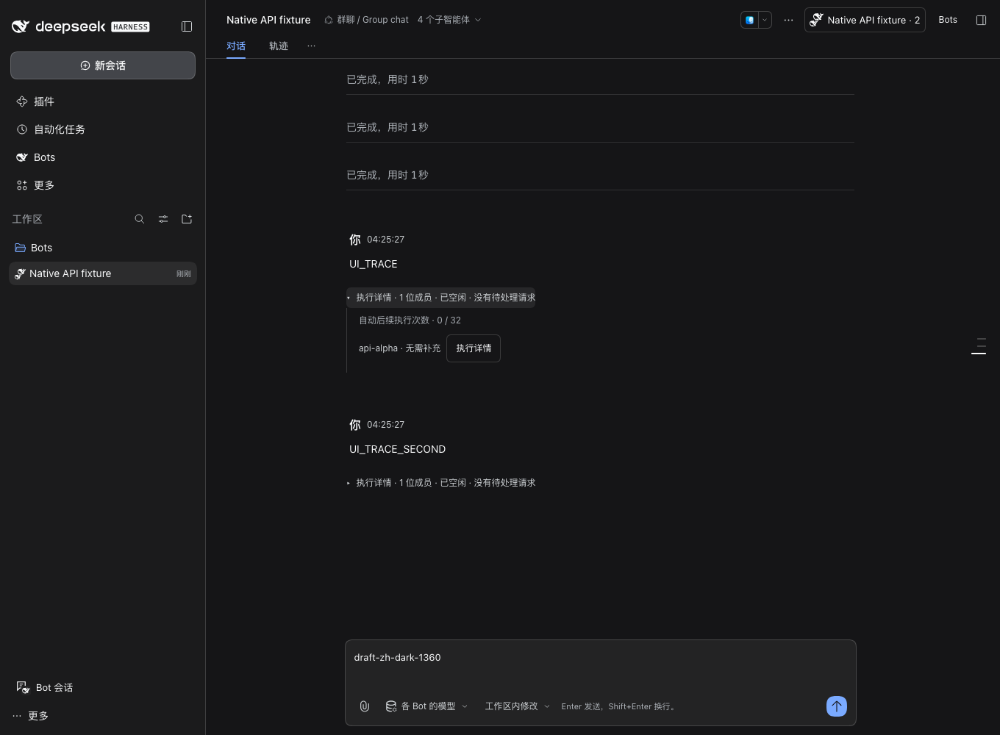
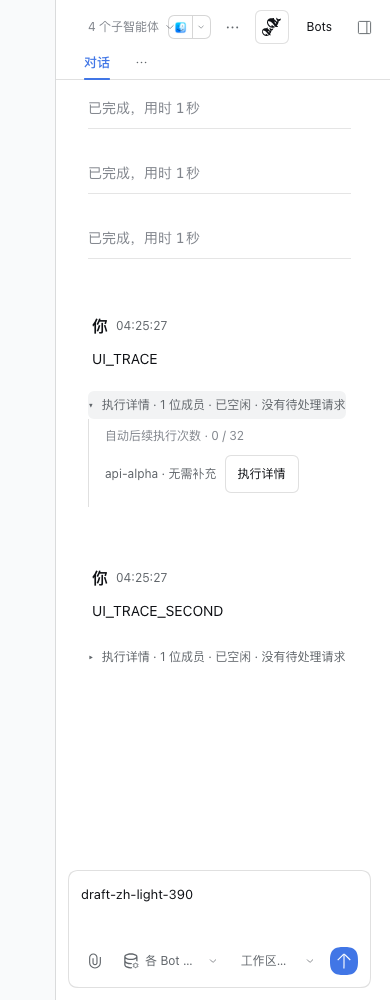

# 执行状态随问题展示

2026-11-01，用户反馈 PR #10 的任务汇总固定放在群输入框上方，历史任务越多越挤压聊天区。现在每条原始问题下方有独立的执行折叠行，默认收起；展开后显示本任务的成员状态、过程入口、补充、停止与继续操作。输入区不再显示历史任务列表或重复状态条。

完整原生思考、工具及正文仍在用户点击后通过既有右侧面板展示；本次不改变调度、模型或原生子会话策略。

## 实现边界

- 精确匹配原始问题的 `turnId` 和 `inputMessageId`，Bot 回复及补充消息不重复渲染任务。旧问题即使不在最新 Remote 消息分页中，也可从原生历史节点获得入口。
- 复用群级共享 view 订阅，输入框与消息不各自轮询同一份数据。最后订阅释放后停止轮询，插件卸载清理缓存和折叠状态。
- 折叠状态由群 ID、创建身份及 turnId 隔离，刷新和消息虚拟化重挂载不会覆盖用户选择。操作使用当前任务 revision，冲突在该问题内显示。
- 沿用既有中英文 locale 和主题 token；没有新增 Host API、依赖、权限、模型调用或数据迁移。

## 验证

| 验收项 | 结果 |
| --- | --- |
| 每条问题独立归属、旧历史、无正文失败 | PASS；5 项新增 DOM 回归，针对性测试合计 27 项通过 |
| 折叠保持、补充草稿及准确操作目标 | PASS；刷新、消息重挂载、停止/取消/继续的 revision 与目标验证通过 |
| 整库检查 | PASS；146 个测试文件，1258 项通过、3 个既有预期失败，build/typecheck/lint 退出 0 |
| 最终实际 tgz | PASS；包元信息、Client 闭包及 186 个 Host 模块 hash 校验通过 |
| rc.2 / rc.5 实际浏览器 | PASS；每个版本 8 组语言/主题/尺寸组合、105 项检查，无浏览器错误；每条问题独立归属，展开不增加输入区高度，查看过程不增加模型请求 |
| 文档与格式 | PASS；本轮文档链接、源码空白及 git diff 检查通过 |
| 正式桌面安装与界面 | PASS；573 个文件匹配，448 个数据文件在重开前未改变；原群四个问题均有独立折叠入口，实际点击可展开 |
| 新真实模型任务质量 | FAIL（NOT_RUN）；仅查看既有记录，没有发送新模型消息 |
| 完整 simplified-bots 历史浏览器流程 | FAIL（NOT_RUN）；更新了受影响定位器，本轮以新增 DOM 与实际执行 UI 矩阵验收 |

整库最终日志为 `.dsh-dev/inline-execution-check-final.log`。第一次完整检查在 Hook 依赖声明 lint 失败，修正后重跑整个 check 退出 0；唯一剩余 lint 信息是既有 quota-process 的模板字符串建议。rc.2 首次 tgz 安装缺少离线 registry 元数据，经包装 CLI 在隔离 profile 补齐依赖缓存后，对最终包的全新隔离运行通过。

最终 rc.5 收据目录 `.dsh-dev/group-execution-ui/1793535915391-38339`；rc.2 为 `.dsh-dev/group-execution-ui/1793535915392-38340`。公开脱敏检查汇总见 [evidence.json](evidence.json)，截图均来自最终包的合成夹具；没有上传正式桌面对话。

线上 CI 以关联 PR 当前提交的 checks 为准。

命令与本地日志：

```sh
scripts/pnpm -F dsh-bot exec vitest run --config ../../vitest.config.ts tests/client/group-inline-execution.spec.tsx tests/client/groups.spec.tsx
scripts/pnpm check
scripts/pnpm -C packages/dsh-bot pack --pack-destination ../../.dsh-dev/inline-execution-pack-final
node scripts/verify-package.mjs .dsh-dev/inline-execution-pack-final/dsh-bot-0.6.3.tgz
DSH_HOME="$PWD/.dsh-dev" DSH_BOT_ARTIFACT="$PWD/.dsh-dev/inline-execution-pack-final/dsh-bot-0.6.3.tgz" node scripts/group-execution-ui.mjs --mock-only
DSH_HOME="$PWD/.dsh-dev" DSH_BOT_DSH_BIN="$PWD/.dsh-dev/native-api-rc2/node_modules/.bin/dsh" DSH_BOT_ARTIFACT="$PWD/.dsh-dev/inline-execution-pack-final/dsh-bot-0.6.3.tgz" node scripts/group-execution-ui.mjs --mock-only
```

候选包 SHA256：`1051f97ddd2e60564767daa8db8f089964588983e2f75caa8a429f2e7274737f`。

## 正式桌面更新

沿用用户上一轮的本地安装与当前试用修复范围，确认群内无运行任务、输入框为空后正常退出 DSH。完整备份保存在 `.dsh-dev/desktop-install-inline-execution-1793536063/dsh-before.tar.gz`，目录 0700、归档与回执 0600；含私人数据，不能上传。执行：

```sh
DSH_HOME="$HOME/.dsh" scripts/dsh plugin --profile desktop add "$PWD/.dsh-dev/inline-execution-pack-final/dsh-bot-0.6.3.tgz"
```

退出 0；安装后 573 个文件与候选 tgz 逐一一致，448 个现有存储/会话/Bot/预设文件在冷启动前摘要未变。重开宿主 rc.5，在原群的四个问题下均看到独立的执行折叠行，展开最后一个问题只显示该问题的成员记录，输入框上方不再聚集历史任务。没有修改宿主本体、模型、权限或发送消息。

## 实际隔离界面





## 改动文件

- `packages/dsh-bot/src/client/components/GroupTurnExecution.tsx`：单问题执行区及操作。
- `packages/dsh-bot/src/client/workspace-group.tsx`：在原始问题节点挂载执行区。
- `packages/dsh-bot/src/client/components/GroupsPanel.tsx`：移除输入区汇总，共享现有群 view。
- `packages/dsh-bot/src/client/styles/groups.module.css`：随消息滚动的紧凑样式。
- `packages/dsh-bot/tests/client/group-inline-execution.spec.tsx`：问题归属、无正文失败、旧分页、折叠保持、按钮目标与草稿回归。
- `packages/dsh-bot/tests/group-native-api-profile.mjs`、`scripts/group-execution-ui.mjs`：真实双问题夹具及浏览器验证，支持检查实际 tgz。
- `scripts/simplified-bots-ui.mjs`：原有运行状态、补充入口断言跟随新位置；本轮不将未运行的完整旧流程计作 PASS。
- `tasks/U-inline-execution.md`、`docs/dsh-api-notes.md`、`docs/PLAN.md` 和本目录：任务、API 复用说明与验证记录。

前一轮遗留的 `docs/verification/group-collaboration/desktop-install.md` 原样保留，不纳入本次修复提交。
