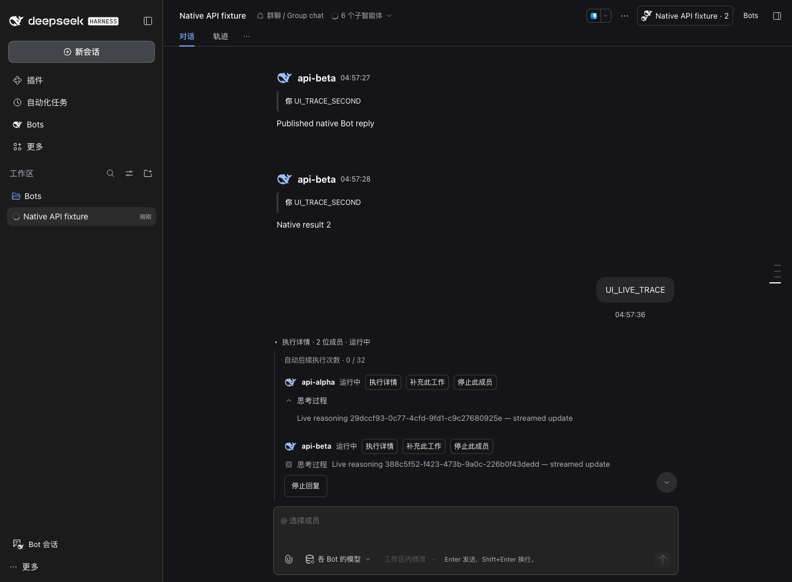
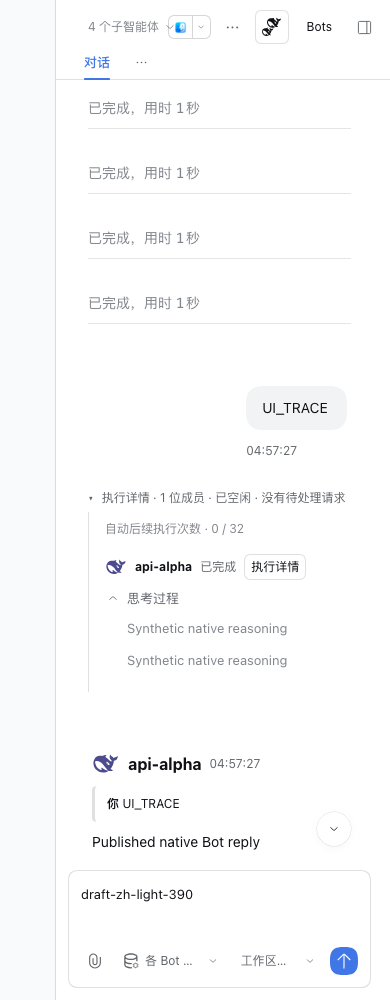

# 原生思考展示与消息左右布局

2026-11-01，分支 `codex/group-inline-execution`。按用户试用反馈修复两处体验：用户消息改为右侧气泡；各 Bot 的头像、回复和思考过程位于左侧。过程继续跟随原始问题滚动，输入区不汇总历史任务。

## 实现与原生复用

每个成员直接观察真实 child Session 的公开 Chat 投影。实时、已完成和中断保留的 reasoning 原文交给官方 `conversation.chat.reasoning.content`，折叠和运行时动效使用官方 `DisclosureRow` / `IconThinkOutlineRegular`。插件只提供群成员身份和调度操作，不复制原生消息解析器。完整工具与更早历史保留在原生右侧详情面板。

运行中的问题默认展示成员，历史问题默认收起；手动选择优先并跨消息重挂载保留。同一持续 worker 的多个 delivery 只挂一次过程，按最新 delivery 显示调度状态。思考正文自身默认折叠成一行，展开后限制高度并可滚动。

新 worker 需要用公开父子地址 retain，不能依赖全局 Session 目录已刷新；starting 阶段仅预留 ID，必须等待原生 activation 创建完成。原生 readiness 可能在 openState=error 时 resolve，故检查公开 Session 快照后再绑定投影。注册、引用及订阅由 ctx.effect / React 生命周期清理，迟到 readiness 不重新挂载视图。

原生完整 Conversation Factory 不能在自身内递归，完整 ReasoningRow / TurnProcessNodeView 也未从公开 Client 根入口导出。本次选择公开的独立 reasoning Factory；群用户气泡用主题 alias 实现布局，无私有组件导入、依赖升级、Host 调度改动或数据迁移。

## 验收

| 项目 | 结果 |
| --- | --- |
| 真实思考原文与成员归属 | PASS；并发两成员、流式更新、多个步骤、中断冻结、隐藏失效节点和避免重复正文的 DOM 回归 |
| 生命周期和启动竞争 | PASS；预留 ID 等待、父子地址、迟到 readiness、读取错误、订阅及引用释放 |
| 默认展开与历史折叠 | PASS；完成自动收起、用户选择保留、同 child 多 delivery 去重、原始问题准确归属 |
| 针对性回归 | PASS；3 文件、33 项，`member-process-tests-final.log` |
| 完整项目检查 | PASS；147 文件、1264 项通过、3 个既有预期失败；build/typecheck/lint 退出 0。仅有既有 quota-process lint info |
| rc.5 实际浏览器 | PASS；8 组中英/明暗/1360/390px，140 项检查，无浏览器错误 |
| rc.2 实际浏览器 | PASS；同一完整矩阵，140 项检查，无浏览器错误 |
| 双成员实时过程 | PASS；两个真实原生 child 经合成适配器先后发出 reasoning delta，界面分别更新；展开收起不增加模型请求 |
| 消息布局与输入区 | PASS；用户气泡靠右、Bot 回复与过程靠左，无横向溢出；展开不增加 composer 高度，草稿保留 |
| 打包 | PASS；候选包元数据、Client 闭包及 186 个 Host 模块 hash；浏览器使用隔离 profile 链接本地构建，未将其描述为 tgz 安装验收 |
| 正式桌面安装与历史展示 | PASS；后续按用户明确授权安装，573 个包文件匹配，465 个数据文件在重开前未变；实际桌面左右布局及历史思考展开/收起通过，见[安装记录](desktop-install.md) |
| 正式桌面真实模型流式过程 | FAIL（NOT_RUN）；未发送真实模型请求，交由用户试用；历史展示及合成适配器验证不代替真实模型验收 |
| GitHub CI | FAIL（NOT_RUN，记录于提交前）；推送后以 [PR #11](https://github.com/MJ-CJM/DSH-Bot/pull/11) 最新提交的 Checks 为准 |

浏览器收据（全部为合成数据）：

- rc.5：`.dsh-dev/group-execution-ui/1793537844517-71572`。
- rc.2：`.dsh-dev/group-execution-ui/1793537913525-73042`。
- 可审阅的检查清单：[evidence.json](evidence.json)。

验证过程中修复了新 child 尚未创建时过早读取、原生读取错误被误当作空思考、以及浏览器测试将 shimmer 的装饰副本当作第二个正文元素的问题。最初几次浏览器失败保留于 `.dsh-dev`；以上 PASS 仅指最终矩阵。

## 命令与候选包

```sh
scripts/pnpm -F dsh-bot exec vitest run --config ../../vitest.config.ts tests/client/group-inline-execution.spec.tsx tests/client/group-member-process.spec.tsx tests/client/groups.spec.tsx
scripts/pnpm check
DSH_HOME="$PWD/.dsh-dev" node scripts/group-execution-ui.mjs --mock-only
DSH_HOME="$PWD/.dsh-dev" DSH_BOT_DSH_BIN="$PWD/.dsh-dev/native-api-rc2/node_modules/.bin/dsh" node scripts/group-execution-ui.mjs --mock-only
scripts/pnpm -C packages/dsh-bot pack --pack-destination ../../.dsh-dev/member-process-pack
node scripts/verify-package.mjs .dsh-dev/member-process-pack/dsh-bot-0.6.3.tgz
```

整库日志：`.dsh-dev/member-process-check-final.log`。候选包：`.dsh-dev/member-process-pack/dsh-bot-0.6.3.tgz`，SHA256 `92f74f4240837485a0d8d99a8489eb835ed96e55d90f80f7338587749267c7e0`。

## 改动文件

- `packages/dsh-bot/src/client/components/GroupMemberProcess.tsx`：原生只读投影、思考折叠及 Factory 渲染。
- `packages/dsh-bot/src/client/components/GroupTurnExecution.tsx`：成员身份、自动展开、持续 child 去重和启动就绪门禁。
- `packages/dsh-bot/src/client/workspace-group.tsx`：传递原生 Factory 渲染能力。
- `packages/dsh-bot/src/client/components/GroupTimeline.tsx`、`src/client/styles/groups.module.css`：用户右侧气泡、Bot 左侧以及过程布局。
- `packages/dsh-bot/locale/en.json`、`locale/zh.json`：新增双语文案。
- `packages/dsh-bot/tests/client/group-member-process.spec.tsx`、`group-inline-execution.spec.tsx`、`platform-primitives.tsx`：行为回归与公开组件替身。
- `packages/dsh-bot/tests/group-native-api-profile.mjs`、`scripts/group-execution-ui.mjs`：原生双成员流式夹具和真实浏览器验证。
- `tasks/U-native-member-process.md`、`docs/PLAN.md`、`docs/dsh-api-notes.md`、本目录：任务、API 记录和证据。

已有 `.agents/` 技能安装和上一轮 `docs/verification/group-collaboration/desktop-install.md` 保留。

提交前文档链接检查通过。本地 `check:format` 扫描到不在本次提交范围内的 `.agents/skills/design-taste-frontend/library/` 四个 JSON 文件缺少末尾换行，原样保留；本次提交的文件范围单独导出后执行相同格式与文档检查，结果另记于 PR。备份、凭据、真实会话与安装日志均不进入提交；仓库截图均来自合成夹具。

## 实际隔离界面




