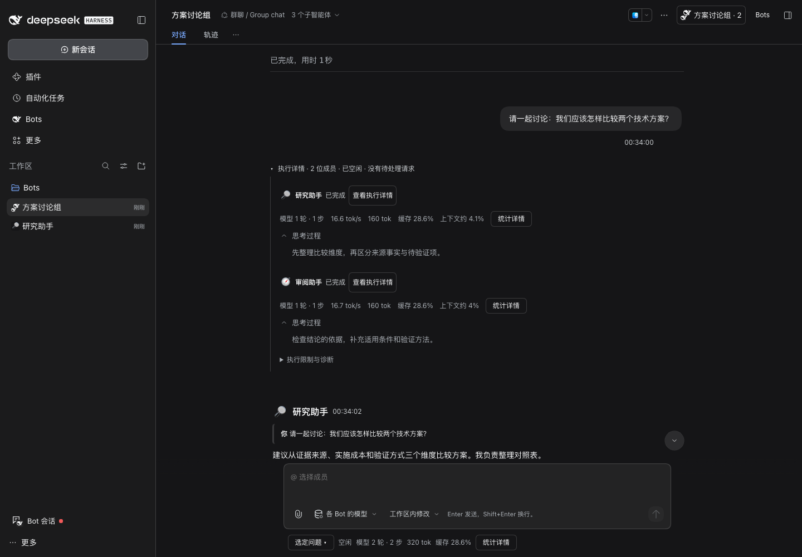

# 群聊统计：S0–S2 验证记录

日期：2026-11-02。关联 [Issue #23](https://github.com/MJ-CJM/DSH-Bot/issues/23)、[Draft PR #24](https://github.com/MJ-CJM/DSH-Bot/pull/24)。
全部 Host 数据、缓存和浏览器数据位于仓库 `.dsh-dev` / `output`；没有修改正式桌面安装或调用外部模型。

## S0 结论与批准方案内的降级

**原生统计 dock 不能在另一个插件位置独立复用；公开 projection 可以。**

rc.2、rc.5 隔离浏览器均尝试了声明 session child `conversation.composer.dock`，并以公开 `renderSlot(..., { only: 'activity'/'usage' })` 渲染。运行时得到：

```text
Error: slot "conversation.composer.dock" is already declared
(by an entry in "conversation.composer.bar" ...)
```

这是 slot 的独占声明规则，不是 React 类型能验证的组合能力；注册失败还会使所属子 scope 的执行详情 tab 被撤销。负向实验仅用于验证，已全部撤除。不能通过强转 `renderSlot`、访问 registry 内部 entries 或导入内部 ActivityPill/UsagePill 绕过。

因此采用已批准方案第 6 节的公开 projection 简要只读方案。复用原生会话引用、projection、已接受的设置、Button/Menu/Modal；只实现薄的数值展示与必要聚合。没有新增统计数据库、Host Remote、计费系统或默认 composer。原生内部统计弹层及 ContextMeter 未复制。

| 验证 | 结果与边界 |
| --- | --- |
| 独立复用 activity/usage dock | **FAIL / 不支持**：rc.2、rc.5 均拒绝重复声明；使用批准的 fallback |
| 准确成员绑定 | **PASS**：公开 `sessions.retain({parentSessionId, childSessionId, mode:'unknown'})`，await `ready` 后读 `binding.session.projections.faceOf` |
| 原生统计读取 | **PASS**：两个版本每个脚本化成员均返回 `sessionStats` 1 轮 / 1 步，`tokenUsage` 100 未缓存输入 + 40 缓存读 + 0 缓存写 + 20 输出 = 160 Token |
| 缓存口径 | **PASS**：成员为 40/140≈28.6%；两成员合计 320 Token，同一 child 不重复累计 |
| 上下文估计 | **PASS**：使用 `projectedTokens ?? pressureTokens`；初始夹具无 contextWindow 时不显示百分比，后续夹具提供 4096 容量；模型切换可识别不一致时省略估计 |
| 设置读取 | **PASS**：公开 `configForms.get('ui-chat')` snapshot/subscribe；真实 Host 详细/简洁均验证。方法需要保留 receiver；不读取私有 optimistic store |
| 全日志范围 | 发布包核查：sessionStats 只 fold 当前会话的 step/end；tokenUsage 累计当前会话的 usage 记录。没有递归归集后代。读取 Host baseline，不从分页 Chat 节点推算 |
| 同一 child 的官方 pill 对照 | **FAIL / 不适用**：独立 pill 组合不支持。替代为实际 Host projection 值与受控请求用量的逐项核对；不宣称已嵌入官方 pill |
| 生命周期 | **PASS（单元/组件）**：共享引用、订阅更新、晚到 ready、卸载、20 次重开释放；100 问题×16 成员仅保留选定问题的 16 个引用 |
| 无额外模型调用 | **PASS（真实隔离 Host）**：展开、切换统计、弹窗、刷新页面前后脚本请求数不变；两个版本冷启动恢复 160 Token，新增模型请求均为 0。网络 guard 禁止真实提供方请求 |

S0 可行路径为公开 projection fallback；没有因 dock 失败引入新的 Host 服务或读取私有状态。锁定的开发依赖未升级。

## S1 / S2 行为

- 每个问题下展开执行详情时显示成员累计统计；当前问题 footer 默认只订阅该问题。折叠且未选中的历史不 retain。
- 同 child 多轮/消息回执去重；`joinedDeliveryId` 不是新 worker；归属冲突排除并标识。旧版同成员多 child 显示累计行，详情分别列出。
- 失败/取消的已知用量保留。无投递、未启动、加载、记录不可用、缺少 projection、尚无提供方用量分别处理；未知不补零。
- 缓存先累计分子/分母；速度/上下文只针对单一 child，不提供群 TPS/群上下文百分比。
- footer 可选历史问题；流式更新不改变手动选择。成功新发送切到新问题，人工补充定位原问题；普通引用旧回答仍按新问题计量。
- 原生 Modal 负责 Escape、焦点恢复；原生 Menu 负责范围选择。遵循已接受的 detailed/compact 设置。窄屏隐藏次要列，详情保留分项。

## 自动化入口与证据

```sh
scripts/pnpm check
scripts/pnpm check:docs
scripts/pnpm check:tooling
DSH_HOME="$PWD/.dsh-dev" node scripts/group-statistics-runtime.mjs --mock-only
DSH_BOT_DSH_BIN="$PWD/.dsh-dev/native-api-rc2/node_modules/.bin/dsh" \
  DSH_HOME="$PWD/.dsh-dev" node scripts/group-statistics-runtime.mjs --mock-only
scripts/pnpm pack:plugin
```

- 新测试：`tests/client/group-statistics.spec.ts`、`group-statistics-ui.spec.tsx`；同时回归既有 inline-execution/member-process suites。
- 浏览器夹具：两个问题（2 成员 / 1 成员）、实际脚本化 usage、原生后台子任务；正常运行 5 次脚本请求，0 次真实模型请求。
- 矩阵：en/light/detailed、zh/dark/detailed、zh/light/detailed、en/dark/compact，各 1440/768/390 px，rc.2 与 rc.5 分开保存。
- 本地截图、ARIA、receipt：`output/playwright/group-statistics/rc2/` 与 `rc5/`。不提交正式个人会话或全量 Host 日志。
- 20 次释放和 16×100 负载为组件/数据源测试，**不是**真实模型压力测试。

最终本地验收：

- **PASS** `scripts/pnpm check`：150 个测试文件，1282 passed / 3 expected fail，构建、类型、lint 通过（保留原有 quota-process.mjs 的 1 条 info）。
- **PASS** tooling：7 项通过。
- **PASS** 提交快照 docs / format：434 个本地链接、1111 个文本文件通过。原工作区这两个命令为 **FAIL**，仅因原有未跟踪 taste-review.md 的私有 skill 链接与 output 截图 JSON 格式；未修改或提交它们。
- **PASS** 真实 tgz：`scripts/pnpm -C packages/dsh-bot pack` 后 `scripts/verify-package.mjs` 验证包字节、Client closure 和 186 个 Host module hashes。只打包候选文件，没有发布 latest 或修改正式安装。
- **PASS** rc.2 / rc.5 浏览器 8 个语言/主题/偏好组合 × 3 宽度；零页面错误，详情 Escape/焦点恢复、历史范围选择、页面刷新、无横向溢出与桌面单行通过。
- **PASS** rc.2 / rc.5 独立 Host 冷启动：恢复原生持久统计，无任务重放，0 新模型请求。
- **FAIL / 未执行** 真实提供方会话和生产桌面验证：本任务按规则只使用隔离脚本化模型，不据此推断真实模型质量或速度。

机器记录：[S0 数据](s0-api-results.json)、[运行矩阵](runtime-results.json)。GitHub CI 以 Draft PR 当前提交的 Checks 为准，不将本地结果代替远端结果。

## 合成数据截图




