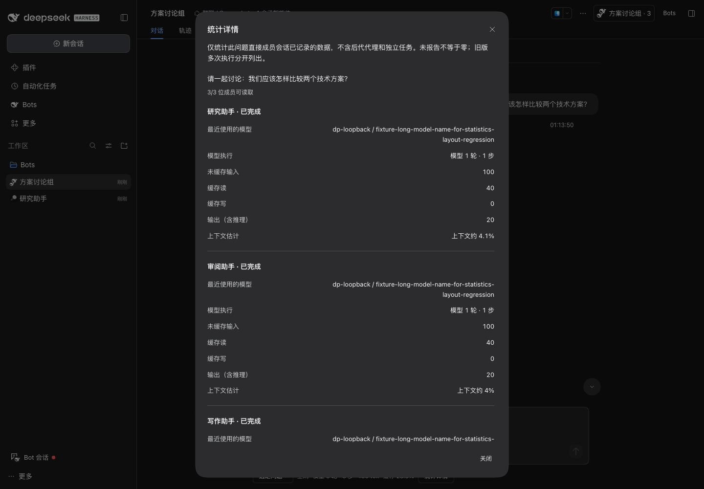
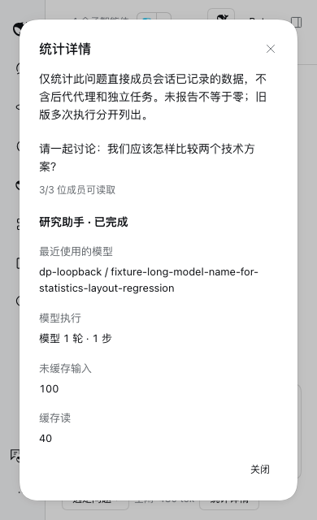

# 统计详情弹窗布局修复

日期：2026-11-02。基于 `feature/group-usage-statistics` / `ac0b529` 的布局修复。

## 问题与修复

用户截图显示卡片超出窗口、正文贴边、标签被长模型名挤窄。旧实现使用 headless Modal；共享包装的样式与原生默认样式同优先级，宽度可能回落至 380px；自行 viewport 高度与原生 overlay 留白规则不一致。旧浏览器检查仅覆盖正文，不检测弹窗边界。

新增回归在旧构建上实测失败：1440×1000 窗口中弹窗 `x=530, y=-352.0625, width=380, height=1704.125`。首次夹具因长模型未列入模型目录而启动失败，补齐脚本化 adapter 的模型目录后才完成此负向复现。

- 群统计和成员统计均直接使用公开原生 Modal 默认标题、关闭、说明、正文及 footer。
- 卡片限制在原生 overlay 的可用范围内，公开 contentClassName 配置内部滚动；底部原生 footer 的关闭按钮不随正文滚动。
- 正文使用原生留白，成员间加入分隔，固定比例双列允许长值换行；480px 以下标签和值上下排列。
- 不改变统计口径、调度、模型请求、会话存储或其他业务弹窗。

## 文件

- `packages/dsh-bot/src/client/components/GroupStatistics.tsx`：默认原生 Modal 及语义内容分组。
- `packages/dsh-bot/src/client/styles/groups.module.css`：边界、滚动与字段布局。
- `packages/dsh-bot/tests/group-statistics-profile.mjs`：3 成员、长模型标识的真实隔离 Host 夹具。
- `scripts/group-statistics-runtime.mjs`：弹窗越界、横向溢出、末项滚动可达、双入口关闭与焦点回归。
- `docs/dsh-api-notes.md`：默认 Modal 用法及高度契约。
- 本记录、`dialog-layout-results.json` 及两张合成数据截图。

## 命令与验收

| 命令/检查 | 结果 |
| --- | --- |
| 旧构建 + 新浏览器回归 | PASS（负向）：捕获弹窗超出 viewport，旧布局验收 FAIL |
| `scripts/pnpm -F dsh-bot exec vitest run tests/client/group-statistics-ui.spec.tsx tests/client/group-statistics.spec.ts` | PASS：2 文件 / 11 测试 |
| `scripts/pnpm check` | PASS：150 文件，1282 passed / 3 expected fail；build/typecheck/lint 通过，保留原 quota-process.mjs 的 1 条 info |
| `DSH_HOME="$PWD/.dsh-dev" node scripts/group-statistics-runtime.mjs --mock-only` | PASS：rc.5，4 组语言/主题/偏好；1440×1000、768×600、390×640 弹窗边界/水平溢出/关闭/最后成员可达；成员入口 390px |
| 同命令加 `DSH_BOT_DSH_BIN="$PWD/.dsh-dev/native-api-rc2/node_modules/.bin/dsh"` | PASS：rc.2 同矩阵；未升级依赖 |
| 双宿主冷启动、额外模型请求 | PASS：持久统计恢复；冷启动请求 0；UI 操作没有新增脚本请求，每夹具 6 次脚本化请求，无真实提供方请求 |
| `scripts/pnpm -C packages/dsh-bot pack --pack-destination ../../.dsh-dev/statistics-dialog-package` + `node scripts/verify-package.mjs .dsh-dev/statistics-dialog-package/dsh-bot-0.6.3.tgz` | PASS：真实包、客户端闭包、186 个 Host module hashes |
| 正式桌面安装后逐文件比对 | PASS：574 文件与包一致 |
| 原有正式数据 | PASS：退出后完整备份；重开前 697 文件摘要未变，仅官方安装的 package.json/pnpm-lock.yaml 更新 |
| 真实桌面只读验证 | PASS：原群 3/3 成员统计恢复；窗口置前后截图确认标题、留白、双列、滚动区及底部关闭按钮完整可见 |
| 真实新模型任务 | FAIL（NOT_RUN）：本次布局修复未发消息或启动真实模型请求 |

机器收据：[dialog-layout-results.json](dialog-layout-results.json)。只对合成数据保存公开截图，正式个人会话截图未写入仓库。

## 本地安装

用户原本要求安装候选并验证统计，本轮修复继续同步本地验证版本；正式桌面正常退出后使用官方命令：

```sh
DSH_HOME="$HOME/.dsh" scripts/dsh plugin --profile desktop add "$PWD/.dsh-dev/statistics-dialog-package/dsh-bot-0.6.3.tgz"
```

退出 0；版本仍为 0.6.3，以包 SHA256 区别：`1cf281d62a8af6cf5f3a24a04788299f16fe6e69a113c4f1ec77d531c1c5afa2`。
备份：`.dsh-dev/desktop-install-statistics-dialog-1793610953/dsh-before.tar.gz`，权限 0600；目录 0700，仅本地忽略目录。
收据：`.dsh-dev/statistics-dialog-install-current.json`。没有升级宿主、提交、推送或更新 PR。

用户已在本地确认修复效果，并授权提交代码与验收证据；原有未跟踪资料保留。

## 合成数据截图




