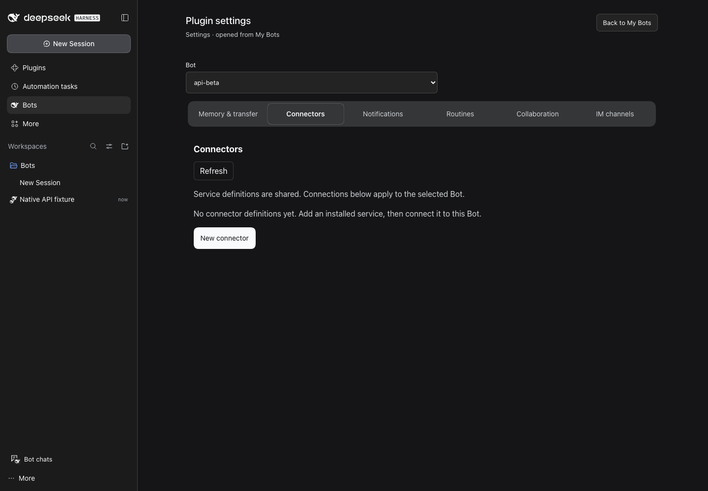
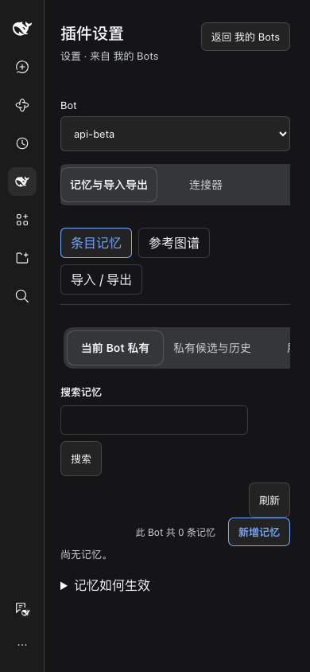
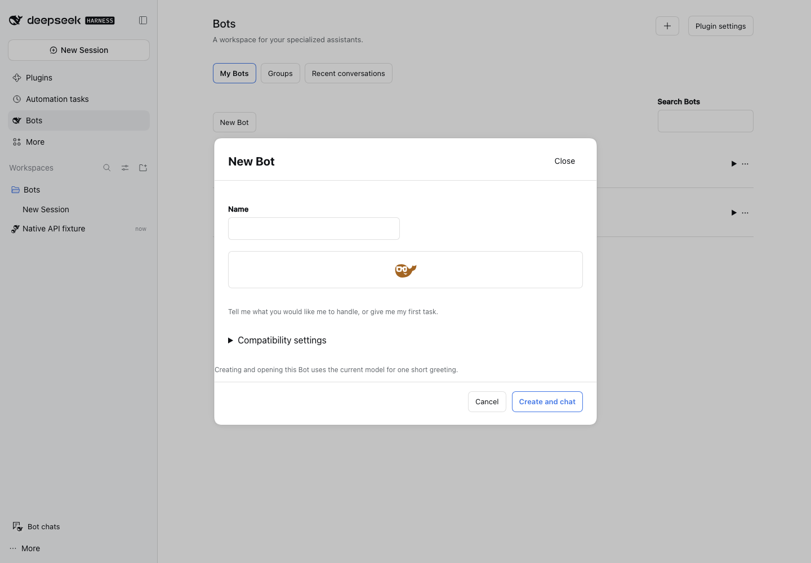

# U0/U1：原生 UI 与设置上下文验证

2026-11-01。基线 `fe5e5ff`（PR #11 已合入）。跟踪 [Issue #12](https://github.com/MJ-CJM/DSH-Bot/issues/12) / [Draft PR #13](https://github.com/MJ-CJM/DSH-Bot/pull/13)。

## U0 已验证的公共契约

使用仓库安装的 rc.2 公共类型，在隔离 DSH Web rc.2、rc.5 中执行。测试 fixture 通过 browser module factory 提供的公共模块表取得 React 和 primitives，并通过插件 Context 的 `slots.inject/register` 注册测试项；不导入内部路径、不读取宿主私有状态。注入仅限测试响应，产物不包含 fixture。

| 能力 | 实际运行结果 | 本阶段决定 |
|---|---|---|
| Modal | 初始焦点、20 次 Tab 焦点约束、嵌套弹窗 Escape、返回触发按钮通过 | 以 headless 模式保留 Bot 标题操作和 busy 按钮，删除插件自己的 mask / focus trap / Escape 实现 |
| Menu | 嵌套时第一次 Escape 关闭菜单，保留 Modal | 继续复用现有官方 Menu；新 UI 不新增菜单实现 |
| Input / Checkbox | 输入、勾选、busy 关闭拦截与两种主题通过 | 连接器/通知采用官方输入与勾选；必须传 required 的确认框保留 HTML input（公开 Checkbox 无 required 参数） |
| SegmentedTabs | ArrowRight 切换选中项和焦点通过 | 管理区采用官方分段控件，页内 panel 与 ID 由插件持有；窄屏允许标签栏横向滚动 |
| settings.section | owner 存在，实际呈现 U0 Section；owner.close 关闭设置并返回原页 | 官方壳可复用；本次保留现有 Bot 管理入口，不复制一份表单到全局设置 |
| settings.plugins.tab | owner 存在，在 Built-in plugins 中实际挂载测试 tab | 可用于未来插件级配置；不是 Bot 数据记录的归属容器 |
| SettingsForm / SettingsFormModel | 输入不写入；Save 一次提交 expectedRevision=7；拒绝保存保留 draft；卸载丢弃 draft | 不直接用于 Bot CRUD。其 namespace、base/user 层与 durable config revision 不等同于 Bot id+createdAt、记录 revision 和业务确认 |
| 主题与尺寸 | rc.2 / rc.5 各覆盖 dark/light × 1440/768/390，无文档横向溢出 | 保留官方主题、字体和颜色 token，不引入第二套 UI 框架 |

**证据边界：** SettingsForm 接入的是 fixture 自有内存 scope，验证了官方模型与 UI 的保存/丢弃契约，未声称完成生产 Host 配置 namespace 写入。参考源码约定目录不可用；以上使用已安装公开包类型与真实 Host 公共模块。无需为 Bot CRUD 增建配置 namespace。原生 SettingsForm 不提供我们的跨 Bot 未保存确认，保留这一薄业务适配。

## U1 行为

- 一个公共 Bot 选择器供连接器、通知、记忆与协作使用。身份绑定 `id + createdAt`，同 ID 重建后显示失效提示，要求显式重新选择。
- 同 Bot 的栏目使用保留面板，非敏感草稿与 DOM 可在分区切换时保留；跨 Bot 确认后卸载整棵旧身份面板。旧请求仍绑定旧 owner，迟到结果不能关闭新对象的编辑器。
- 原有返回来源、列表搜索、选中、滚动、焦点与未保存确认继续沿用。没有新增一套页面路由。
- 记忆进入稳定导航，移除统计和重复身份标题；默认展示记忆搜索与空态/条目。工作机制说明可展开。任务与 IM 明确标注全局作用域，避免将全局统计说成当前 Bot 的统计。
- 连接器/通知默认列表或空态，新建/编辑才挂载表单；保存成功关闭表单，失败保留输入，取消走未保存确认。保存中锁定字段和提交，凭据仍由原生 credentials 服务管理。
- 新建 Bot 未开始工作区请求时显示“创建时使用共享 Bots 工作区”，不再伪装为持续加载。

## 复现

从仓库根目录运行，使用 `scripts/pnpm` 和 `scripts/dsh`。所有配置、会话、凭据与临时目录都在 `.dsh-dev` 下；不修改桌面安装或用户 DSH 配置。

```sh
scripts/pnpm check
DSH_HOME="$PWD/.dsh-dev" node scripts/native-settings-spike.mjs
DSH_HOME="$PWD/.dsh-dev" node scripts/settings-ui-verify.mjs
```

rc.2 验证：先准备隔离 rc.2 CLI，然后将 `DSH_BOT_DSH_BIN` 设为其可执行文件，并设置 `U0_VERSION=rc2`。当前机器的测试 CLI 为 `.dsh-dev/native-api-rc2/node_modules/.bin/dsh`，不是产品硬编码依赖。未设置时 wrapper 选择本地 CLI；报告版本必须与 CLI 实际版本匹配。

输出（不进入发布包）：`output/playwright/native-settings/<version>/results.json`、`output/playwright/settings-ui/<version>/results.json` 及 PNG。U1 脚本覆盖中文/英文、亮暗、三种宽度，实际点击并断言 Bot 身份、草稿确认、原生 portal 和记忆首屏位置。测试 fixture 会先执行既有群聊 mock 场景；其 loopback 模型请求与真实模型请求分开记录。

U2–U4、群聊算法、真实模型/IM/Teams、桌面安装和大数据性能不在本 PR 验收范围。

## 最终本地验收

| 项目 | 结果 |
|---|---|
| U0 rc.2 / rc.5 | PASS：各 14 项 API/行为检查；两套 owner 均实际挂载 |
| U1 rc.2 / rc.5 | PASS：各 36 张页面矩阵截图 + 2 张原生创建弹窗；共 76 张。记忆搜索与空态均在首屏可见 |
| `scripts/pnpm check` | PASS：148 个测试文件，1267 passed / 3 expected fail；build、typecheck、lint 通过。3 个既有 expected fail 不是新增失败 |
| `scripts/pnpm check:tooling` | PASS：7/7 |
| 未提交审查/Skill 的检查边界 | 工作目录的 check:format/check:docs 会扫描之前已有的 `.agents` 和 `output` 审查材料，因其末尾换行/非公共 Skill 链接报错；未修改这些历史材料。PR 导出树 check:docs/check:format 均 PASS；工作目录噪声未计入发布通过 |
| GitHub CI | 以 PR #13 当前提交的 Ubuntu/macOS check-and-pack 为准 |

原始运行回执：[U0 rc.2](receipts/native-settings-rc2.json)、[U0 rc.5](receipts/native-settings-rc5.json)、[U1 rc.2](receipts/settings-ui-rc2.json)、[U1 rc.5](receipts/settings-ui-rc5.json)。截图仅为隔离测试数据。







## 本 PR 改动文件

```text
docs/PLAN.md
docs/dsh-api-notes.md
docs/verification/native-settings/README.md
docs/verification/native-settings/receipts/native-settings-rc2.json
docs/verification/native-settings/receipts/native-settings-rc5.json
docs/verification/native-settings/receipts/settings-ui-rc2.json
docs/verification/native-settings/receipts/settings-ui-rc5.json
docs/verification/native-settings/screenshots/connectors-dark.png
docs/verification/native-settings/screenshots/memory-narrow.png
docs/verification/native-settings/screenshots/native-modal-light.png
packages/dsh-bot/locale/en.json
packages/dsh-bot/locale/zh.json
packages/dsh-bot/package.json
packages/dsh-bot/src/client/components/BotEditor.tsx
packages/dsh-bot/src/client/components/BotTransferPanel.tsx
packages/dsh-bot/src/client/components/CollaborationPanel.tsx
packages/dsh-bot/src/client/components/ConnectorEditor.tsx
packages/dsh-bot/src/client/components/ConnectorsPanel.tsx
packages/dsh-bot/src/client/components/IntegrationFrame.tsx
packages/dsh-bot/src/client/components/ManagementHeader.tsx
packages/dsh-bot/src/client/components/ManagementPanel.tsx
packages/dsh-bot/src/client/components/ManagementWorkspace.tsx
packages/dsh-bot/src/client/components/MemoryPanel.tsx
packages/dsh-bot/src/client/components/Modal.tsx
packages/dsh-bot/src/client/components/NotificationsPanel.tsx
packages/dsh-bot/src/client/components/ReferenceMemoryPanel.tsx
packages/dsh-bot/src/client/components/RetainedPanel.tsx
packages/dsh-bot/src/client/components/SettingsBotContext.tsx
packages/dsh-bot/src/client/components/SharedMemoryPanel.tsx
packages/dsh-bot/src/client/memory-drafts.ts
packages/dsh-bot/src/client/pages/BotsPage.tsx
packages/dsh-bot/src/client/styles/bots.module.css
packages/dsh-bot/src/client/styles/integrations.module.css
packages/dsh-bot/src/client/styles/memory.module.css
packages/dsh-bot/src/client/styles/settings.module.css
packages/dsh-bot/tests/client/bots-navigation.spec.tsx
packages/dsh-bot/tests/client/integrations.spec.tsx
packages/dsh-bot/tests/client/management.spec.tsx
packages/dsh-bot/tests/client/platform-primitives.tsx
packages/dsh-bot/tests/client/settings-context.spec.tsx
packages/dsh-bot/tests/native-settings-fixture.tsx
pnpm-lock.yaml
scripts/native-settings-spike.mjs
scripts/settings-ui-verify.mjs
tasks/U0-U1-native-settings.md
```
