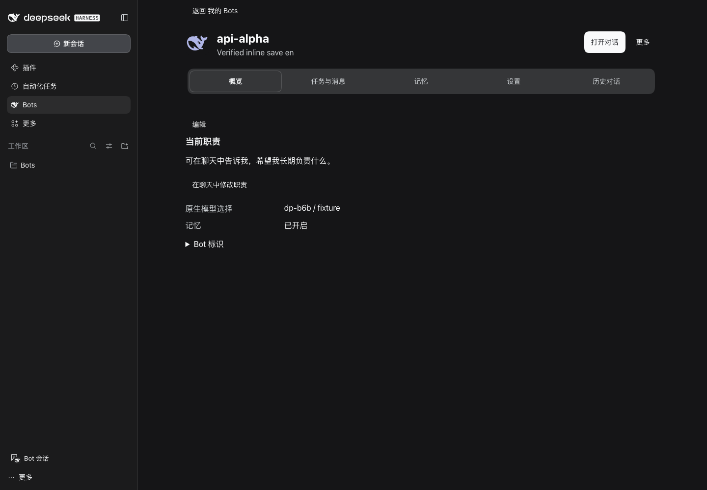
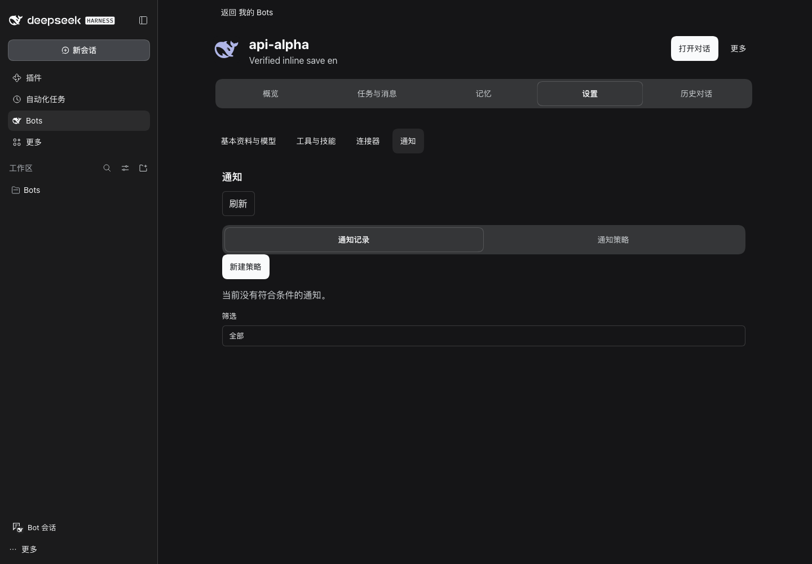
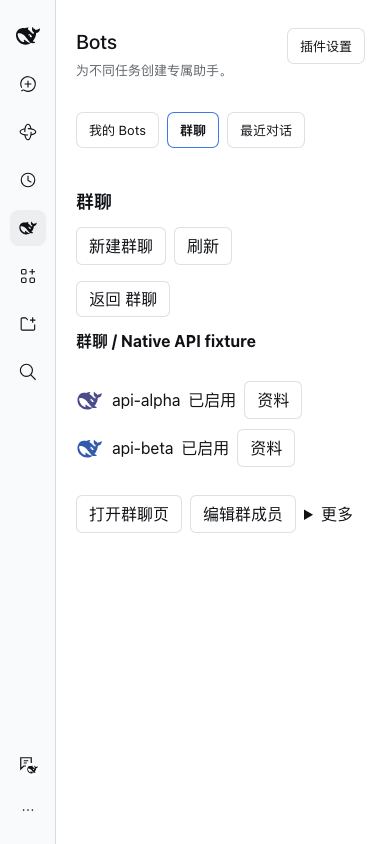
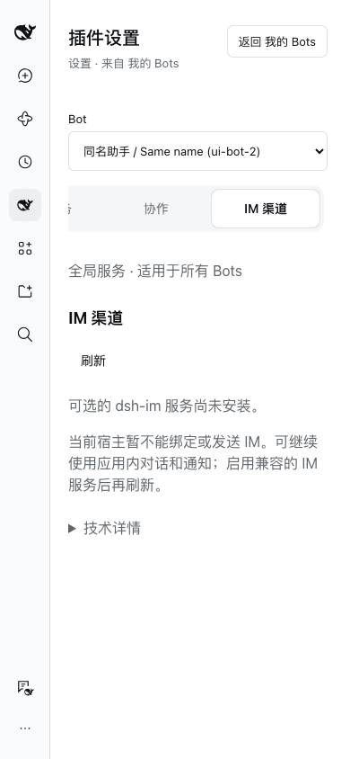

# U2–U4 UI 优化验收

2026-11-01。跟踪 [Issue #14](https://github.com/MJ-CJM/DSH-Bot/issues/14)，以 U0/U1 合入提交 `0084f0d` 为基线。
分阶段审查：U2 [PR #15](https://github.com/MJ-CJM/DSH-Bot/pull/15) → U3 [PR #16](https://github.com/MJ-CJM/DSH-Bot/pull/16) → U4 后续 PR。保持 Draft，不自动合并。

## 最终行为

- Bot 资料为页内页面，包含概览、任务与消息、记忆、设置和历史；列表保留直达聊天和明确资料入口。快速创建仍是原生 Modal。返回恢复搜索、滚动及焦点；草稿在标签切换时保留，离开时确认。
- 共享 BotIdentity 显示头像、名称、摘要，同名补充稳定标识；两种侧栏复用同一身份呈现，去除重复管理入口。
- 群聊逐问题默认一行，可展开成员的原生思考；查看详情直达原生只读会话，补充/停止成员进入原生菜单，整轮停止单独标明。次数限制在高级诊断中，原有预算与停止协议保持。
- 群资料在窄屏单列呈现，可返回列表；编辑成员时保留草稿确认。
- 通知记录与策略分开，空态明确；IM 只显示状态、可用替代路径与折叠技术信息，保持原门控。说明原生 Team 是单 Bot 内任务委派、群聊是独立 Bots 讨论。
- 图谱以状态、查询为主，新增表单与诊断按需展开；复制与遗忘先说明影响，技术明细折叠。删除仍有生日/版本、运行中和数量校验。
- 导出、导入分开：选择范围后准备/下载 JSON，原生 JsonBlock 折叠显示详情；文件（最大 1 MiB）或粘贴导入，保留原 schema、预览、冲突检查、凭据/路径排除和确认。导出不覆盖导入草稿，迟到文件读取不覆盖新输入。

## 原生复用与边界

| 能力 | 处理 |
| --- | --- |
| Button / Input / Checkbox / SegmentedTabs / Menu / Modal / Toast | 公开 ui-primitives；菜单、焦点、键盘、Portal、成功提示由宿主负责。清理重叠输入框及废弃 Toast/详情样式。 |
| JSON 展示 | 公开 `JsonBlock({label,payload,defaultOpen,truncatedLabel})`，双宿主实测真实导出内容。 |
| 思考和执行详情 | 原生 Chat projection、reasoning factory、child Session 与只读 factory；只观察，不启动模型。 |
| 模型/工具、任务、记忆、连接器 | 继续复用已有公共服务与 Remote；Bot 的身份、归属、修订号、导入预览是插件领域语义，不能交给通用 SettingsForm 替代。 |
| 派发 prompt | 公开完整会话 factory 没有安全裁剪内部派发信息的参数。保留只读原生详情，不改日志、不从私有组件导入。 |
| 页面导航 | 保持插件内客户端状态；宿主侧栏切换、关闭应用不保存未提交草稿。本轮没有承诺拦截宿主级导航。 |

## 逐项验收

| 验收项 | 结果与证据 |
| --- | --- |
| build、完整测试、typecheck、lint | PASS：148 文件，1271 passed、3 expected fail（既有预期失败断言，不计作通过）；最终工具草稿/导入补测 15 项通过。lint 只有既有 quota-process 提示。 |
| 构建/CLI 可移植性、候选包检查 | PASS：7 项 tooling 检查。 |
| rc.2 / rc.5 实际页面矩阵 | PASS：每宿主 264 张截图，22 个页面状态 × 中英 × 亮暗 × 1440/768/390；50 Bot、同名长名、返回焦点、草稿确认、实际保存/Toast、下载/文件导入预览、窄屏群返回。见 receipts。 |
| 群原生执行过程和成员操作 | PASS：两个宿主各 8 个语言/主题/宽窄组合；包含实时双成员思考、菜单 Escape、补充只填草稿、停止一个成员后另一个仍运行、展开不追加模型请求。 |
| 消息左右布局、原生只读详情、资源释放 | PASS：群 UI 检查用户右/Bot 左、详情没有 composer、关闭卸载，客户端测试检查释放/迟到结果。 |
| 最终 tgz | PASS：全部包字节、元数据、Client closure、186 Host 模块摘要；实际隔离安装。 |
| 真模型/第三方 IM/正式桌面升级 | FAIL（未运行，超出本轮 UI 范围）：所有运行请求来自本地合成 provider；没有修改正式 DSH profile，不将合成结果当真实任务质量。 |

UI 矩阵每宿主 10 次合成模型请求，真实模型请求 0；群实时检查的计数见各自收据。GitHub CI 另在 Issue/PR 中记录，不用本地检查推断远端状态。

安装候选：`.dsh-dev/ui-completion-final/dsh-bot-0.6.3.tgz`。
SHA-256：`0203b5ea815c32d81f93c82408b41d959325a0ef78599e7418fa99c4a3241516`。
完整矩阵验证该最终包；群专项最初验证的包与最终包仅 README 不同，Host/Client/locale 字节相同，最终包另做群专项复验。

## 命令与复现

从仓库根运行，所有 Host、浏览器临时文件、storage、sessions 位于 `.dsh-dev`，fixture 禁止外网模型：

```sh
scripts/pnpm check
scripts/pnpm check:tooling
scripts/pnpm -C packages/dsh-bot pack --pack-destination ../../.dsh-dev/ui-completion-final
node scripts/verify-package.mjs .dsh-dev/ui-completion-final/dsh-bot-0.6.3.tgz
UI_VERSION=rc5 DSH_BOT_ARTIFACT="$PWD/.dsh-dev/ui-completion-final/dsh-bot-0.6.3.tgz" node scripts/ui-completion-verify.mjs
UI_VERSION=rc2 DSH_BOT_DSH_BIN="$PWD/.dsh-dev/native-api-rc2/node_modules/.bin/dsh" DSH_BOT_ARTIFACT="$PWD/.dsh-dev/ui-completion-final/dsh-bot-0.6.3.tgz" node scripts/ui-completion-verify.mjs
DSH_HOME="$PWD/.dsh-dev" DSH_BOT_ARTIFACT="$PWD/.dsh-dev/ui-completion-final/dsh-bot-0.6.3.tgz" node scripts/group-execution-ui.mjs --mock-only
```

rc.2 群检查同样设置 `DSH_BOT_DSH_BIN`。文档/格式检查在只含 PR 文件的导出树执行，避免此前未跟踪 Skill/审查输出干扰；不删除或重写这些材料。完整本地日志位于 `.dsh-dev/u4-*.log`，截图位于 `output/playwright/ui-completion/{rc2,rc5}`。

## 截图复核

沿用已批准的 Taste 应用界面方向，保留 DSH 字体和主题。实际检查并修正原生输入框重复描边、长名称压缩、窄屏群双列和执行操作拥挤；高级操作仍可达，不把模拟数据当业务指标。未给出未经测量的设计评分。






## 文件与后续

改动清单见 [files.txt](files.txt)；U2、U3 分阶段记录分别见 [U2.md](U2.md)、[U3.md](U3.md)。审核按 PR 依赖顺序进行；合入后可使用上述候选包进行正式桌面人工验收。没有未完成的 U2–U4 实现项；尚未开放的 IM/托管能力及原生 prompt 裁剪限制不属于本轮新增实现。
